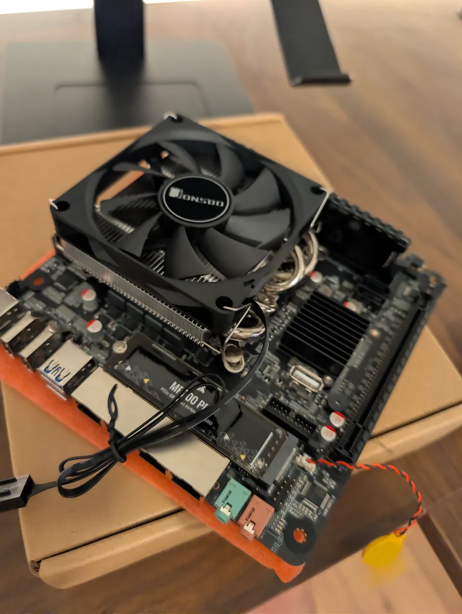
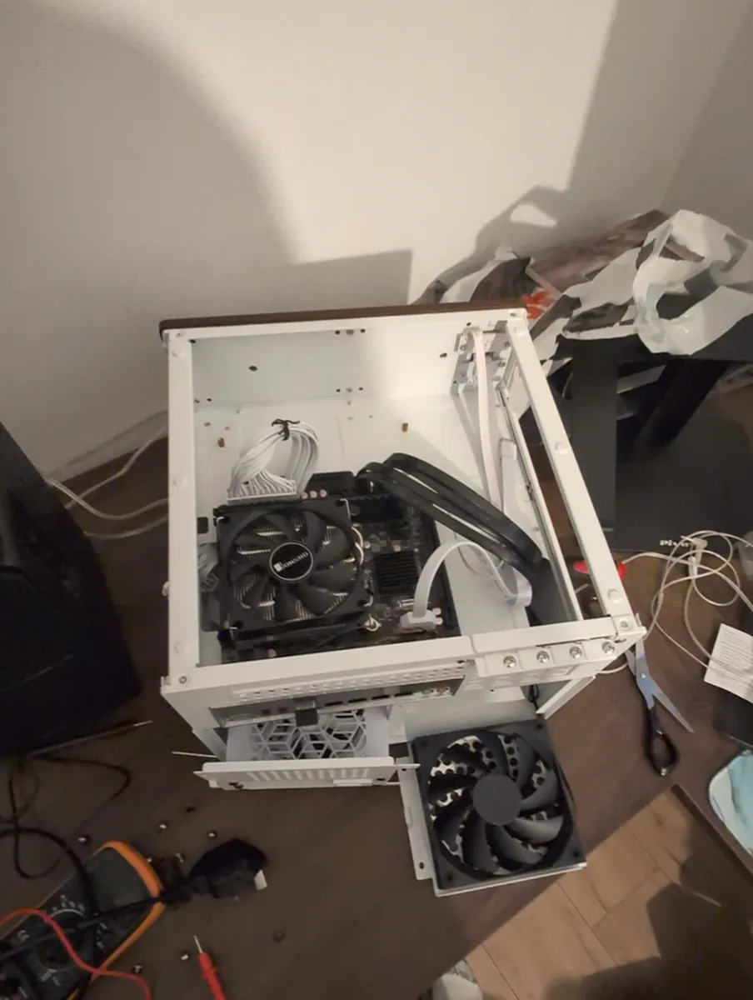
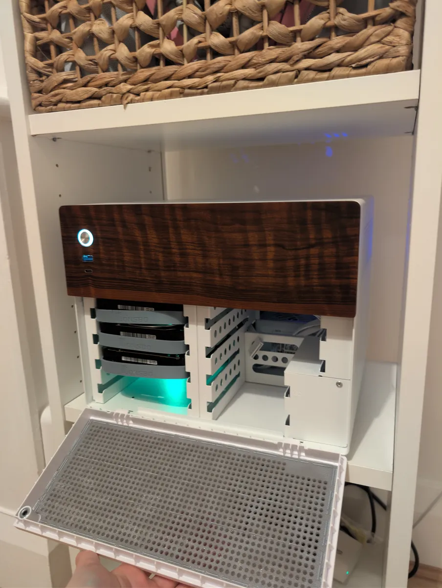

This is the home server I built in mid 2026: a small NAS-style box running
[Proxmox VE](https://www.proxmox.com/en/products/proxmox-virtual-environment/overview),
with a few services I use every day. It replaces Google Drive for my files,
keeps my notes in sync, runs game servers to play with friends, and has room for smart
home and CCTV later on.

This guide covers the parts I chose, their cost, how the storage is
laid out, and each service I run. It also tells the longer story of finding a
Google Drive replacement. I tried [Nextcloud](https://nextcloud.com) and
[Seafile](https://www.seafile.com/en/home/) before settling on
[OpenCloud](https://opencloud.eu), and I haven't looked back.

> **Work in progress:** the server is still growing, and so is this guide.
> Sections marked _planned_ aren't built yet.

> **About the commands:** most commands here run as root in the Proxmox host
> shell (_Node → Shell_ in the web UI) or inside a container's console. I've
> kept them to the important ones; the Proxmox web UI can do almost all of it
> by clicking too.

## 1. The hardware

I wanted something quiet and low-power with room for several hard drives.
Most of the parts are used or bought from marketplaces, which kept the cost
down a lot. The 8th-gen Intel CPU, for example, cost £22 on eBay.

| Part         | What I used                                                          | From       | Price       |
| ------------ | -------------------------------------------------------------------- | ---------- | ----------- |
| Case         | [Jonsbo](https://www.jonsbo.com) N4 NAS case (6× 3.5" bays, 2× 2.5") | AliExpress | £107.07     |
| Motherboard  | Intel C246 NAS board (8× SATA, 3× 2.5 GbE + 1× 1 GbE)                | AliExpress | £94.70      |
| CPU          | Intel Core i5-8500 (6 cores, UHD 630 graphics)                       | eBay       | £22.00      |
| CPU cooler   | Jonsbo HP400S low-profile                                            | AliExpress | £19.29      |
| Power supply | Corsair SF750 (SFX, 80 PLUS Platinum)                                | eBay       | £92.51      |
| RAM          | 32 GB Kingston DDR4 2666 MHz (single stick)                          | CeX        | £82.50      |
| Boot SSD     | Corsair MP700 PRO 2 TB NVMe                                          | CeX        | £172.50     |
| Hard drives  | 2× WD Purple 4 TB (WD40PURZ)                                         | CeX        | £130.00     |
| Additional Hard drive   | 1× WD Red Pro 4 TB (WD4001FFSX)                                      | CeX        | £80.50      |
|              |                                          and                            | **Total**  | **£801.07** |

A few notes on these choices:

- **The CPU's built-in graphics matter.** The UHD 630 can handle hardware
  video transcoding and AI object detection for CCTV, so the server doesn't
  need a graphics card.
- **The NVMe drive is overkill.** It's a PCIe Gen5 drive running at Gen3
  speeds, because that's all the motherboard supports. It was a good deal,
  though, and it's still far faster than the hard drives.
- **WD Purple drives are surveillance drives**, made to be written to 24/7.
  They're fine for general storage and ideal for CCTV recordings.
- **One RAM stick** leaves a slot free to go to 64 GB later.

From the bare motherboard to the finished server on the shelf:

|  |  |  |
| ------------------------------------------------------------------------------------------------------------------------------- | ---------------------------------------------------------------------------------------------------------------------- | ---------------------------------------------------------------------------------------------------------------------------- |

## 2. Proxmox and storage

[Proxmox VE](https://www.proxmox.com/en/products/proxmox-virtual-environment/overview)
is a free, Debian-based operating system for running virtual machines (VMs)
and containers. Everything is managed from a web UI at
`https://<server-ip>:8006`. I'm running Proxmox VE 9.2.

### How the storage is split

There are two places to store things, and each one gets what it's best at:

- **The NVMe SSD** holds Proxmox itself and the system disk of every
  container and VM, plus databases and game worlds. Anything where speed
  matters goes here.
- **The three hard drives** form a [ZFS](https://openzfs.org/wiki/Main_Page)
  pool called `datapool` in a _RAIDZ1_ layout. That gives about 7.3 TB of
  usable space and survives one drive failing. Bulk data goes here: files,
  notes, CCTV recordings and backups.

> **Pitfall:** it's tempting to use a spare SSD as a cache for the ZFS pool.
> With 32 GB of RAM a read cache (L2ARC) helps very little. A "special vdev"
> on a single SSD is worse: if that SSD dies, **the whole pool is lost**. Put
> the fast stuff straight on the NVMe instead and you get the speed with none
> of the risk.

### First-time setup

**Switch to the free update repository.** A fresh Proxmox install points at
the paid _enterprise_ repositories, so updates fail without a subscription.
In the web UI go to _Node → Updates → Repositories_, disable the two
enterprise entries, then _Add → No-Subscription_. Then update:

```bash
apt update && apt full-upgrade -y
```

**Cap the ZFS memory cache.** ZFS uses spare RAM as a read cache (the ARC).
Capping it at 4 GB makes sure containers and VMs always get the rest:

```bash
echo "options zfs zfs_arc_max=4294967296" > /etc/modprobe.d/zfs.conf
```

```bash
update-initramfs -u -k all
```

**Create a dataset for each kind of data**, with compression on. Datasets
are like folders that can each have their own settings and snapshots:

```bash
zfs create -o compression=lz4 datapool/notes
zfs create -o compression=lz4 datapool/opencloud
zfs create -o compression=lz4 -o recordsize=1M -o atime=off datapool/cctv
zfs create -o compression=lz4 datapool/backups
```

**Check the integrated graphics are visible**, so containers can use them
later:

```bash
ls -l /dev/dri
```

You should see `renderD128`. If `/dev/dri` is missing, enable the integrated
graphics in the BIOS.

## 3. Containers, VMs and what runs where

Proxmox can run two kinds of guests:

- **LXC containers** share the host's Linux kernel. They're very light,
  start in seconds and can share the integrated graphics. I use these for
  almost everything.
- **VMs** are fully separate machines. I use them only where it's worth it:
  for anything exposed to the internet (game servers), and for
  [Home Assistant](https://www.home-assistant.io), whose official install is
  a whole OS image.

Each service gets its own container with a fixed IP address on the home
network, so a problem in one can't take down the others.

| Service                                         | Type | Resources      | Status            |
| ----------------------------------------------- | ---- | -------------- | ----------------- |
| [Tailscale](https://tailscale.com)              | LXC  | 1 core, 512 MB | Running           |
| [OpenCloud](https://opencloud.eu)               | LXC  | 2 cores, 2 GB  | Running           |
| [Syncthing](https://syncthing.net) (notes)      | LXC  | 1 core, 512 MB | Running           |
| Game servers                                    | VM   | 6 cores, 10 GB | Running (Valheim) |
| [Home Assistant](https://www.home-assistant.io) | VM   | 2 cores, 4 GB  | _Planned_         |
| [Frigate](https://frigate.video) (CCTV)         | LXC  | 4 cores, 3 GB  | _Planned_         |
| [Immich](https://immich.app) (photos)           | LXC  | 4 cores, 6 GB  | Tried, stopped    |

The core and RAM numbers are limits, not reservations. An idle container uses
almost nothing, so it's fine for them to add up to more than the machine has.

> **Why Immich is stopped:** Immich is an excellent self-hosted Google Photos
> replacement, and it ran well here with hardware transcoding on the iGPU. In
> the end I stayed on Google Photos because it's simpler for the rest of my
> family to use. Its data is kept on the pool in case I bring it back.

### The "Docker in LXC" recipe

Most services are easiest to run with Docker, so I reuse the same recipe for
each container:

1. Create the container (_Create CT_, top right) from the
   `debian-13-standard` template. Tick **Unprivileged** and **Nesting**, put
   the disk on `local-lvm` (the NVMe), and give it a static IP.
2. Under _Options → Features_, tick **keyctl** and **nesting**.
3. In the container's console, install
   [Docker](https://docs.docker.com/engine/install/debian/):

```bash
apt update && apt full-upgrade -y && apt install -y curl
curl -fsSL https://get.docker.com | sh
```

To give a container access to a dataset on the pool, add a _bind mount_ from
the host:

```bash
pct set 109 -mp0 /datapool/opencloud,mp=/mnt/opencloud
```

> **Pitfall:** in an
> [unprivileged container](https://pve.proxmox.com/wiki/Linux_Container),
> user IDs are shifted by 100000 on the host. A user with ID 1000 inside the
> container is 101000 on the host. Set the folder's owner to match, or the
> container gets "permission denied":
> `chown -R 101000:101000 /datapool/opencloud`

## 4. Remote access with Tailscale

[Tailscale](https://tailscale.com) is a VPN that connects your devices to
each other without opening any ports on the router. I run it as a
[subnet router](https://tailscale.com/kb/1019/subnets) in a tiny container,
which makes the whole home network reachable from my phone or laptop
anywhere. With the Tailscale app switched on, I use the same addresses as at
home.

It also survives moving house or changing internet provider, because the
server connects out to Tailscale rather than waiting for connections in.

The container needs access to the host's TUN device. Add these two lines to
`/etc/pve/lxc/<id>.conf` on the host:

```text
lxc.cgroup2.devices.allow: c 10:200 rwm
lxc.mount.entry: /dev/net/tun dev/net/tun none bind,create=file
```

Then inside the container, install Tailscale, allow routing and advertise
the home network:

```bash
curl -fsSL https://tailscale.com/install.sh | sh
```

```bash
echo 'net.ipv4.ip_forward = 1' > /etc/sysctl.d/99-tailscale.conf
sysctl -p /etc/sysctl.d/99-tailscale.conf
```

```bash
tailscale up --advertise-routes=192.168.1.0/24 --accept-dns=false
```

Finally, in the [Tailscale admin console](https://login.tailscale.com/admin/machines),
approve the route and **disable key expiry** for this machine, otherwise it
logs out every 180 days.

> **Nothing else is port-forwarded.** The only exception is the game
> servers, because friends shouldn't need a VPN just to join a game.

## 5. Files: Nextcloud → Seafile → OpenCloud

This was the part that took the longest. I wanted a Google Drive replacement
with a few must-haves:

- Lots of files, synced quickly between my PC, laptop and phone
- A normal folder on the PC, so any app can open and save files
- **Editing documents and spreadsheets on every device**, phone included,
  with changes saved back to the server

### Attempt 1: Nextcloud

[Nextcloud](https://nextcloud.com) is the best-known option and does far
more than files: calendars, contacts, photos, office documents and a big app
store.

I first tried mounting it as a drive in GNOME Files through _Online
Accounts_ (WebDAV). Files opened fine, but saves from an office app never
made it back to the server. The desktop sync client fixed that on the PC.

Phones were the bigger problem. I added Nextcloud Office
([Collabora](https://www.collaboraonline.com/code/)) for editing, which
needed the container's RAM raised to 6 GB. Editing in the Nextcloud app
worked, but the overall phone experience felt clunky. Opening files in the
[ONLYOFFICE](https://www.onlyoffice.com) app saved some formats in place but
made duplicate copies for others. For what I needed, it was a lot of server
for a mediocre result.

### Attempt 2: Seafile

[Seafile](https://www.seafile.com/en/home/) is lighter and known for very
fast sync. I set it up with
[ONLYOFFICE Docs](https://www.onlyoffice.com) as its online editor, and it
worked.

Even so, it was still a sizeable stack: Seafile, a MariaDB database, Redis, a
Caddy proxy and an ONLYOFFICE document server, again around 6 GB of RAM.
Seafile also stores files in its own block format, so the data on the server
isn't a folder of your files, and backups need Seafile's own method.

### Where I ended up: OpenCloud

[OpenCloud](https://opencloud.eu) is a newer project (2025), a fork of
ownCloud Infinite Scale. It does one thing, files, and does it well. And I
love it.

What won me over is how **simple** it is:

- **No database** to look after. The whole thing runs comfortably in 2 GB of
  RAM.
- **Modern apps** for
  [desktop](https://flathub.org/apps/eu.opencloud.desktop.opencloud),
  [Android](https://play.google.com/store/apps/details?id=eu.opencloud.android)
  and iOS (all on the [download page](https://opencloud.eu/en/product/download-apps)),
  and sync is extremely fast.
- **Spaces**, shared folders like Google's Shared Drives, for things like
  house documents.
- **No office server at all.** Instead of running an online editor, I edit
  files directly with [ONLYOFFICE](https://www.onlyoffice.com) on every
  device: the
  [desktop editors](https://flathub.org/apps/org.onlyoffice.desktopeditors)
  on Fedora, and ONLYOFFICE Documents on
  [Android](https://www.onlyoffice.com/office-for-android.aspx) and
  [iOS](https://www.onlyoffice.com/office-for-ios.aspx). It's the same editor
  everywhere, files open the same everywhere, and the server only has to
  store and sync them.

That last point is the big one. Dropping the online editor removed most of
the complexity, and nothing was lost.

### Setting up OpenCloud

OpenCloud is set up with the official
[opencloud-compose](https://github.com/opencloud-eu/opencloud-compose)
files, which include [Traefik](https://traefik.io/traefik/) as the web
server. Inside a Docker LXC:

```bash
git clone -b stable-7.2 https://github.com/opencloud-eu/opencloud-compose.git /opt/opencloud
```

Copy `.env.example` to `.env` and set at least:

```bash
OC_DOMAIN=cloud.example.com
OC_DATA_DIR=/mnt/opencloud/data
INITIAL_ADMIN_PASSWORD=<something random>
```

Then start it:

```bash
docker compose up -d
```

The [OpenCloud docs](https://docs.opencloud.eu) cover every setting.

> **Pitfall:** OpenCloud **requires HTTPS and a domain name**, because its
> login uses OpenID Connect. Plain `http://<ip>` won't let you log in.

My setup for that, without exposing anything to the internet:

1. Move the domain's DNS to [Cloudflare](https://www.cloudflare.com) (free
   plan).
2. Add an `A` record for `cloud.example.com` pointing at the container's
   **private** home IP, set to _DNS only_ (grey cloud). Outside the home
   network, it only works with Tailscale on.
3. Create a Cloudflare API token with _Edit zone DNS_ permission, and have
   Traefik get a [Let's Encrypt](https://letsencrypt.org) certificate using
   the DNS challenge. This works even though the server isn't reachable
   from the internet, and it renews by itself.

> **Pitfall:** some routers block DNS answers that point to private
> addresses ("DNS rebind protection"). Check with
> `getent hosts cloud.example.com`. If it prints nothing, allow your domain
> in the router's settings.

### Using it

- **PC and laptop:** install
  [OpenCloud Desktop](https://flathub.org/apps/eu.opencloud.desktop.opencloud)
  from Flathub and pick a local folder to sync. It's a normal folder, so
  GNOME Files and ONLYOFFICE work on it as usual, and saves upload within
  seconds.
- **Phone:** install the OpenCloud app, then edit with ONLYOFFICE Documents
  via _Open with_.

> **Pitfall:** don't edit files through a WebDAV mount (like GNOME Online
> Accounts). Saves from office apps may never reach the server. Use the sync
> client.

## 6. Notes: Obsidian with Syncthing

My [Obsidian](https://obsidian.md) notes are a plain folder of Markdown
files. [Syncthing](https://syncthing.net) keeps an identical copy on the
server, PC, laptop and phone. Obsidian on each device just opens the local
folder.

Because the server copy is always on, my phone and PC stay in sync even when
one of them is off. And because the server holds real Markdown files rather
than a database, I can back them up easily and script things with them
later.

## 7. Game servers

Game servers run in their own VM, because they're the one thing reachable
from the internet, so they get full isolation. It's a Debian VM with Docker,
with up to 10 GB of RAM. That's enough for one or two game servers at a time.

[Valheim](https://github.com/lloesche/valheim-server-docker) is running at
the moment, with Minecraft and Enshrouded planned. Each game only needs its
own ports forwarded on the router to the VM, for example UDP 2456–2457 for
Valheim.

## 8. Backups

ZFS redundancy is **not** a backup. It protects against a drive dying, not
against deleting the wrong folder, a bad command, theft or fire. The goal is
the 3-2-1 rule: 3 copies, on 2 different devices, 1 off-site.

- **Done:** a nightly Proxmox backup of every container and VM to the pool
  (_Datacenter → Backup_), keeping 7 daily, 4 weekly and 3 monthly copies.
- **Planned:** hourly ZFS snapshots with
  [sanoid](https://github.com/jimsalterjrs/sanoid), as an undo button for
  deleted files.
- **Planned:** an off-site copy of the important datasets.

> **Pitfall:** Proxmox container backups **don't include bind mounts**. My
> OpenCloud files live on a bind-mounted dataset, so they need snapshots and
> an off-site copy of their own.

## What's next

- [Home Assistant](https://www.home-assistant.io) in a VM for smart home
  control
- [Frigate](https://frigate.video) for CCTV, using the iGPU for person and
  car detection
- Finishing the backup setup: snapshots and off-site
- Looking into reactivating immich for image storage, depending on personal requirement changes.
