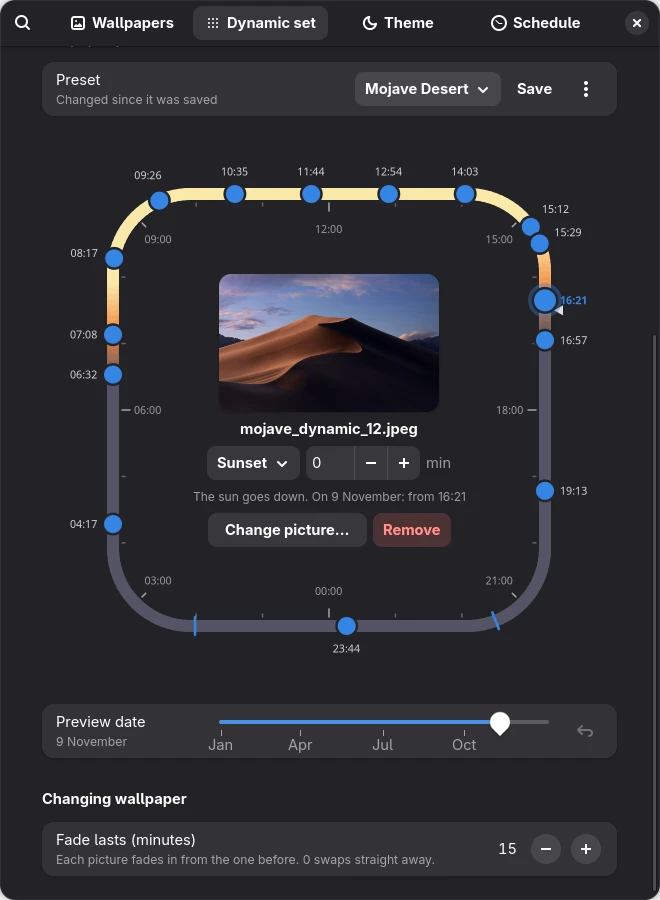
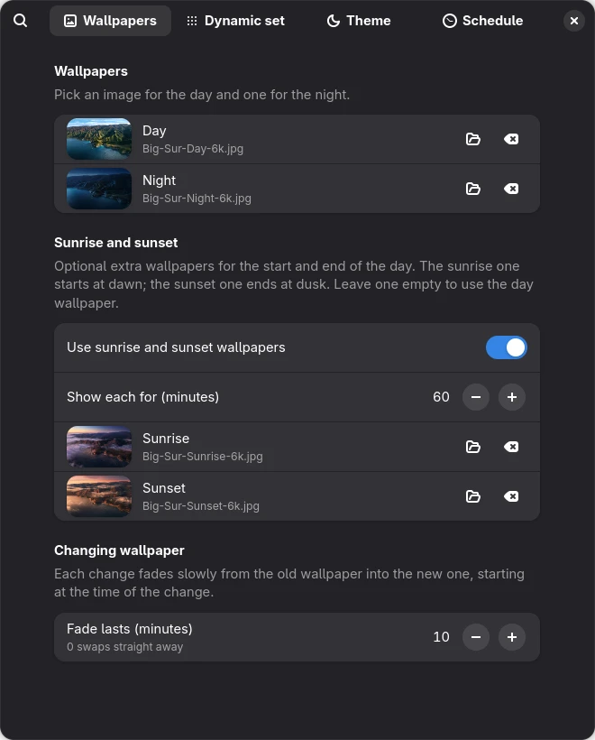
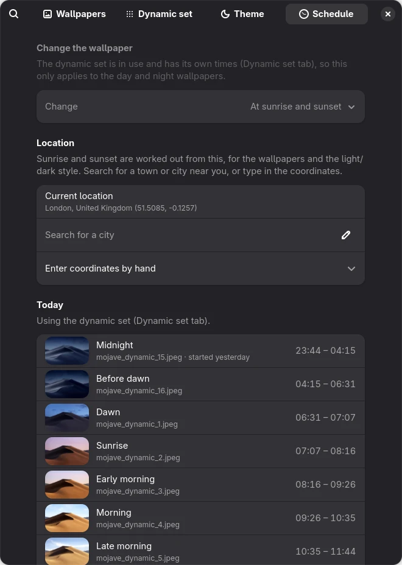
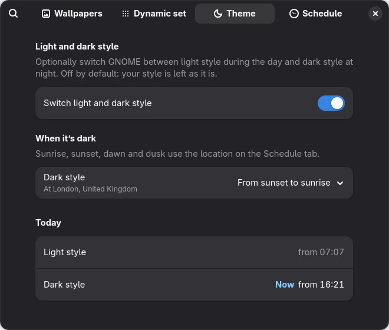

## Idea & introduction

macOS has dynamic wallpapers that slowly change through the day, from a
bright daytime picture to a darker one at night. I wanted the same thing
on my Fedora laptop running GNOME. I didn't want it to run on a fixed
timer, though. I wanted it to follow the actual sun where I live, so the
night wallpaper shows up at 16:00 in a Manchester winter and much later in
summer.

That became Dynamic Wallpaper, a GNOME Shell extension. You pick a day
picture and a night picture, plus optional sunrise and sunset ones. The
extension switches between them at the right moment, with a slow fade in
between. You can also place any number of pictures around a 24-hour clock,
or have it switch GNOME between light and dark style on its own schedule.

It was also my first time writing a GNOME extension, so a big part of the
project was learning how GNOME Shell loads and runs extensions.

> Complete transparency: this extension was built with the help of Claude,
> an AI assistant, as noted in the project's README.

## Technologies used

- JavaScript (GJS, GNOME's JavaScript runtime) for both the extension and
  its settings window
- GTK 4 and libadwaita for the settings window
- GSettings to store the settings, shared by the extension and the settings
  window
- libgweather for offline city search, using the same city list as GNOME
  Weather
- GNOME's own slideshow XML format to do the actual wallpaper changes
- A small test suite run with `gjs` (56 tests), plus a `Makefile` for
  testing, installing and packaging

## Notable features

- **Day and night wallpapers**, switched at sunrise and sunset for your
  location, or at times you choose
- **Optional sunrise and sunset wallpapers**, starting at dawn and ending at
  dusk (an hour each by default)
- **Slow fades** between wallpapers, as long as you like (15 minutes by
  default)
- **City search** that works offline, or type in the coordinates by hand
- **A Dynamic set** of any number of pictures placed around a 24-hour clock,
  by time of day or by the sun's position, so they follow the seasons
- **Presets**, so you can save several dynamic sets and swap between them
- **Light and dark style switching**, on its own schedule and off by
  default
- The right wallpaper shows **from the moment you log in**, with no flash of
  the old one

The Dynamic set clock is the most involved part of the settings window. The
track is coloured by how high the sun is, and each dot is a picture. Dots
can be dragged around the clock and snap to sun events like dawn, sunrise or
dusk. The preview date slider shows how those times move through the year.

| Wallpapers                                                                               | Schedule                                                                           | Theme                                                                            |
| ---------------------------------------------------------------------------------------- | ---------------------------------------------------------------------------------- | -------------------------------------------------------------------------------- |
|  |  |  |

## How it works

### Working out the sun

The sunrise and sunset maths uses the standard "sunrise equation", which is
accurate to a minute or two. Dawn and dusk are civil twilight, when the sun
is 6° below the horizon. The awkward cases needed handling too: near the
poles the sun may not rise or set at all, and far north in summer it never
gets fully dark.

To decide which wallpaper should show, the code builds a list of changes for
the days around today (e.g. "06:26 sunrise → 07:26 day → 16:01 sunset →
17:01 night"). It then finds where "now" falls in that list. Looking at
several days instead of just today avoids special code for the tricky
cases: just after midnight, nights that start after midnight, and time zones
far from Greenwich.

### Letting GNOME do the switching

My first version simply set a new wallpaper at each change. The problem was
that GNOME draws the wallpaper at login **before** it starts any extensions.
So you'd briefly see whatever was set when you last shut down, then a swap
to the right picture.

The fix was to use a feature GNOME already has. Its built-in day/night
wallpapers are really slideshow XML files that list pictures, how long each
one shows, and how long the fade lasts. The extension writes one of these
files for the next 24 hours and points the wallpaper at it. GNOME then
works out the right picture from the clock as soon as it loads, does the
fades itself, and keeps it right after sleep. The extension just rewrites
the file at each change, so it never drifts as sunrise moves through the
year.

### Keeping it light

Wallpapers are often huge (the ones I use are 6K). The extension now makes
screen-sized copies of each picture in the background and uses those in
the slideshow instead. For a 6K picture, that cuts the memory GNOME needs
for it from about 145 MB to about 15 MB.

## Getting it ready to publish

Extensions on [extensions.gnome.org](https://extensions.gnome.org) are
reviewed by hand, and there are rules about what code running inside GNOME
Shell is allowed to do. For example, it shouldn't block the desktop while
reading or writing files, so the extension reads and writes its slideshow
files asynchronously. Everything it sets up when it's turned on also has to
be undone when it's turned off. I ran it through `shexli`, a linter for
these rules, before uploading.

## What I learned

- **How GNOME Shell runs extensions.** The extension runs inside the shell
  itself. A mistake can affect the whole desktop, and new code only loads
  after logging out and back in.
- **Use what the platform already does.** The slideshow approach removed a
  lot of code (timers, fades, catching up after sleep) and fixed the login
  flash at the same time.
- **Dates and times are hard.** Time zones, daylight saving and places where
  the sun doesn't set all needed handling and tests.
- **Building a custom widget in GTK 4.** The 24-hour clock is drawn by
  hand with Cairo, and the dragging and snapping are handled in code too.

## Files

The code is available in a
[GitHub repository](https://github.com/eusebiuxii/dynamic-wallpaper-gnome-extension),
under the GPL-2.0-or-later licence, the same as GNOME Shell. The repository
also includes a set of guides that explain how GNOME extensions work, how
this one works, and how to build and release it.
